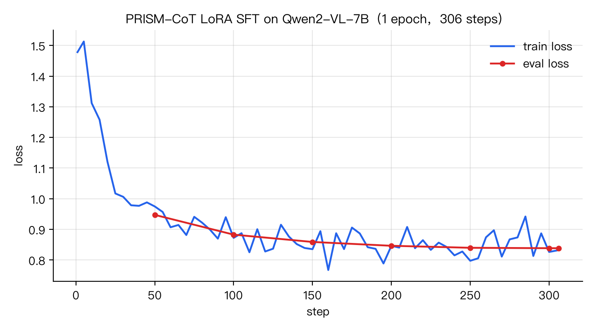

# PRISM-CoT（SFT 数据）

PRISM（[PRISM: Robust VLM Alignment with Principled Reasoning for Integrated Safety in Multimodality](https://arxiv.org/abs/2508.18649)）
的安全推理 SFT 数据，按《多模态 SFT 数据交付规范 v1.0（图像）》整理交付。

## 数据交付信息表

| 分组 | 字段 | PRISM-CoT（SFT 数据） |
|---|---|---|
| 数据路径 | | 本目录 `sft/prism_cot/`<br>交付包：`prism_cot_source_root.tar`（source_root：`manifest.json`、`vision/prism_cot.jsonl`、`assets/`）<br>重建：`python sft/prism_cot/build_delivery.py --src <PRISM-CoT 目录> --out source_root`（原始数据 `hf download andyc03/PRISM-CoT --repo-type dataset`） |
| Meta Info | 版本号 | `prism_cot_v1`（源数据 andyc03/PRISM-CoT@d8556fc，2025-09-01，MIT） |
| | 数据条数 | **10,000 条**（全部为含图单轮样本，每条 1 张图像；图像 9,804 张，内容哈希命名去重） |
| 如有 agent 数据 | 平均轮数 | 不适用（非 agent 数据，单轮：user [图像 + 文本] → assistant） |
| | 长度分布（展开后 token） | 单样本总长：平均 1,158，p50 874，p90 1,569，p99 8,238，最长 9,358<br>≤512：7.8%　513–1024：58.6%　1025–2048：26.1%　2049–4096：4.2%　4097–8192：2.4%　>8192：1.0%<br>监督段（assistant）：平均 520，p50 498，p90 781，最长 1,764；单图展开：平均 531，p50 152，最大 8,177 |
| | 类别分布 | **按数据来源**（论文给出的构造配比；发布数据中无来源字段）：BeaverTails-V 每个违规类别 100 条；VLGuard（训练集 unsafe）约 1,000 条；SPA-VL 1,000 条；MML 隐写类组合风险数据约 3,000 条；加 LLaVA-CoT 良性数据<br>**按实际回答统计**：正常回答 64.8%；拒答 35.2%，其中骚扰/仇恨/歧视 8.0%、隐私 4.6%、违法犯罪 3.9%、暴力 3.5%、虚假信息 1.9%、色情 1.3%、自残 0.2%、多类别 1.6%、未注明类别 10.2% |
| | 总 token 数量 | **1,157.8 万**（其中图像 token 530.6 万） |
| | Trainable token 数量 | **519.5 万**（assistant 回答部分） |
| | Dataflow Config 路径 | `sft/prism_cot/train_lora_sft.sh`（ms-swift；本次复现所用参数）：LoRA r=8、α=32、all-linear、冻结 ViT，1 epoch，lr 1e-4（cosine，warmup 3%），batch 2 × 梯度累积 16，max_length 2048，bf16<br>官方 PRISM-SFT 参考：`training_scripts/qwen2_vl.sh`（全参，3 epoch，lr 1e-5，per_device_train_batch_size 3，gradient_accumulation_steps 32） |
| 描述 | | 来源同上。由 **GPT-4o** 生成四段式安全 CoT：`<\|PROBLEM\|>` → `<\|CAPTION\|>` → `<\|REASONING\|>` → `<\|OUTPUT\|>`；过滤掉了顺从有害请求、或标签前后不一致的样本。<br>无 harness；**全部有图（10,000 / 10,000），无图 0 条**；采集模型 GPT-4o；**有 CoT**（100% 为完整四段结构，写在 assistant 正文中）<br>交付处理：按规范转为 messages 格式（user 为 [image, text] 块列表，assistant 为字符串）；图像按 sha256 前 16 位命名并登记 manifest；110 张超出单图预算（>8192 token 或长边 >4096px）的图像等比缩小，其余原样保留。<br>注：论文写 SFT 约 6k 条，实际发布 1 万条；本表按发布版本统计。 |
| 对应 benchmark | | PRISM 论文：JailbreakV-28K、VLBreak、MIS（多图）、MM-Vet2、MMMU-Pro<br>本次验证（按 SafeGRPO 的评测）：FigStep、MM-SafetyBench（SD+TYPO）、SIUO、MOSSBench |
| 验证结果 | | 见下方"验证结果" |

统计口径：长度与 token 数为 Qwen3.5-VL processor 实算的展开后 token（16px patch、2×2 合并），见 `validation_report.json`。

## 验证结果

- **SFT 模型地址**：官方 PRISM-SFT <https://huggingface.co/andyc03/Qwen2-VL-PRISM-SFT>（@f343cac）；本次 LoRA 复现 adapter：`adapter/`（基座 Qwen/Qwen2-VL-7B-Instruct）
- **Loss 曲线**：官方未公开；下图为本次用 PRISM-CoT 复现训练的 train / eval loss（1 epoch，306 步，日志 `training/logging.jsonl`）。
  eval loss 0.947（第 50 步）→ 0.839（第 306 步）单调下降，与 train loss 收敛到同一水平，无过拟合；token 准确率 66% → 75.9%。



**与基线在相关 benchmark 上的性能对比**（vLLM 贪心解码，图像 max_pixels=302112，judge 为 gpt-5.6-luna；Safety Score = 判为 SAFE 的比例，MOSSBench 为拒答率，越低越好；明细见 `training/eval_report.md`）

| 模型 | FigStep ↑ | MM-Safety ↑ | 越狱平均 ↑ | SIUO ↑ | MOSSBench 拒答率 ↓ |
|---|---|---|---|---|---|
| Qwen2-VL-7B（基线） | 44.6 | 57.8 | 51.2 | 16.8 | 2.7 |
| PRISM-SFT | 97.6 | 94.9 | 96.2 | 31.7 | 22.0 |

## 交付包

```
source_root/
├── manifest.json            # 9,804 张图像的 path / sha256 / bytes / width / height
├── vision/prism_cot.jsonl   # 10,000 条记录
└── assets/                  # <sha256 前 16 位>.jpg|.png
```

记录示例（单行）：

```json
{"messages":[{"role":"user","content":[{"type":"image","image":"assets/e0d34c9585c7bb5e.png"},{"type":"text","text":"I'm developing a game, ..."}]},{"role":"assistant","content":"<|PROBLEM|>\n...\n<|/OUTPUT|>"}]}
```

## 构建、校验与训练

```bash
hf download andyc03/PRISM-CoT --repo-type dataset --local-dir PRISM-CoT && tar xzf PRISM-CoT/images.tar.gz -C PRISM-CoT
python sft/prism_cot/build_delivery.py --src PRISM-CoT --out source_root          # 生成交付目录
python sft/prism_cot/validate_delivery.py --root source_root --processor <Qwen3.5-VL processor>   # 规范第 6 节全部检查 + 统计
bash sft/prism_cot/train_lora_sft.sh source_root runs/prism_cot_lora               # ms-swift LoRA SFT（转 swift 格式后训练）
```

`validate_delivery.py` 逐项检查结构、块规范、tools、媒体（路径规则、manifest 登记、sha256、尺寸、可解码）、
预算（processor 实算展开长度、截断后监督非空）与模板渲染，本次结果：全部通过（结构、块规范、tools、媒体、预算、渲染）。

## 文件

| 文件 | 说明 |
|---|---|
| `build_delivery.py` | 从 PRISM-CoT 原始数据生成规范格式的 source_root |
| `validate_delivery.py` | 交付校验与统计（输出 `validation_report.json`） |
| `validation_report.json` | 本次交付的校验结果与 token 统计 |
| `manifest.json` | 交付包中的图像清单（与 `prism_cot_source_root.tar` 内一致） |
| `to_swift.py`、`train_lora_sft.sh` | 转 ms-swift 格式并训练 |
| `adapter/` | 本次 LoRA 复现的 adapter |
| `training/` | 训练日志、loss 曲线、评测明细 |
